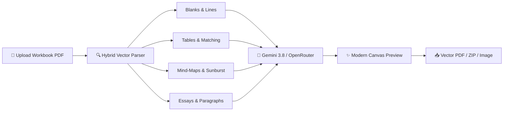

<div align="center">

# 🎓 PrepMate PDF
### *AI-Powered English Workbook & Homework Solver*

<p align="center">
  <b>English</b> &nbsp;|&nbsp; <a href="README_TR.md">Türkçe</a>
</p>

[](https://github.com/Rel0adediso/Prepmate-PDF/releases)
[](https://python.org)
[](https://aistudio.google.com)
[](#)

<p align="center">
  Autonomous AI workbook & homework solver engineered for college prep classes and ESL students.<br/>
  Fills exercises with natural handwriting aesthetics and exports <b>Acrobat-standard vector PDFs</b>.
</p>

<p align="center">
  <a href="https://github.com/Rel0adediso/Prepmate-PDF/releases/latest">
    
  </a>
</p>

</div>

---

> [!NOTE]
> **🌟 What's New in v1.1.0:** Spacious Editor Canvas • Zero-Overflow Header • 40-step Undo/Redo (`Ctrl+Z`/`Ctrl+Y`) • Eye-care Parchment Mode • 1-Click Clipboard Image Copy • Multilingual UI (EN / TR).

---

## 🚀 Quick Start in 10 Seconds

> **No coding, Python installation, or terminal commands needed!**
> 1. Download **`PrepMate-PDF.exe`** from the **[Windows Download (.EXE)](https://github.com/Rel0adediso/Prepmate-PDF/releases/latest)** button above.
> 2. Double-click the executable to launch the desktop app.
> 3. Click **"🔑 AI Key"** in the top bar and paste your free key from [Google AI Studio](https://aistudio.google.com/app/apikey).

---

## 🌟 Why PrepMate PDF?

| Feature | Generic OCR / AI Tools | 🎓 PrepMate PDF v1.1.0 |
| :--- | :---: | :---: |
| **Interface & Design** | Cluttered, clinical, overwhelming | **Warm Obsidian & Terracotta editorial aesthetic** |
| **PDF Quality** | Flattened, blurry screenshots | **Vector-crisp original resolution preserved** |
| **Alignment Accuracy** | Overlaps lines and questions | **Pixel-perfect line & bounding box detection** |
| **Night Study Mode** | Blinding white PDF background | **Parchment Mode: Soft warm paper filter** |
| **Cheat Sheet Modal** | Tedious scrolling through pages | **Numbered answer list with 1-click clipboard copy** |
| **Humanized Student Feel** | Robotic 100% perfection (suspicious) | **~95% realistic grade simulation with natural touch** |
| **CEFR Level Control** | Uncontrolled vocabulary difficulty | **A1 to C1 proficiency level selector** |
| **Mind-Maps & Diagrams** | Fails or skips circular layouts | **Full sunburst, branching & spider diagram solver** |
| **Inline Proofreading** | Blindly writes answers | **5.8pt supralinear corrections over crossed-out words** |
| **Undo / Redo Support** | Irreversible accidental deletions | **40-step comprehensive `Ctrl+Z` / `Ctrl+Y` stack** |
| **Export Flexibility** | Dumps full textbook needlessly | **Homework-Only PDF, Full Textbook PDF, or Clipboard Image** |

---

## 🛠️ Architecture & How It Works



* **🎨 Warm Obsidian & Terracotta Aesthetic:** Editorial typography (`Newsreader` serif), warm accents, and an eye-soothing dark canvas.
* **🌙 Eye-Care Parchment Mode:** Softens harsh white textbook glare into warm vintage parchment during late-night study hours.
* **📋 Rapid Cheat Sheet (Answer Key):** Clean numbered list (`#1`, `#2`, ...) of every solution on the active page for instant copying.
* **📸 1-Click Clipboard Image Copy:** Exports full resolved high-dpi page image directly to clipboard for pasting into WhatsApp Web or Discord.
* **🎭 Natural Student Mode (~95% Score):** Realistic student behavior mode that avoids robotic perfection, preventing teacher AI detection.
* **🎯 CEFR Difficulty Tuning (A1 - C1):** Calibrate vocabulary and grammatical complexity specifically to your course syllabus.
* **🧠 Mind-Map & Sunburst Solver:** Accurately fills radial bubble diagrams, concept maps, and category trees.
* **✍️ 5.8pt Supralinear Corrections:** Overwrites typos cleanly above crossed-out words without text collisions.

---

## 💻 Step-by-Step Usage Guide

1. **Load Your Workbook:** Drag & drop your PDF file or click *"🎯 Try Sample Homework"*.
2. **Configure Pages & Level:** Enter page range *(e.g., `12-18`)*, select your CEFR proficiency level, and toggle *Natural Student Mode* if desired.
3. **Solve Automatically:** Click *"⚡ Fetch Pages & Solve"*. Fast concurrent workers process all selected pages in seconds.
4. **Review & Fine-Tune:**
   - Drag answer text boxes with your mouse or double-click to edit content directly.
   - Use `Ctrl + Z` to undo or `Ctrl + Y` to redo any edits.
   - Enable `🌙 Parchment Mode` for relaxed viewing.
   - Click `📋 Cheat Sheet` for a quick text answer overview.
5. **Export Your Results:**
   - **📄 Download Homework Only:** Compiles only the assigned solved pages into a clean, ready-to-submit PDF.
   - **📚 Download Full Book:** Injects solutions into the full textbook while leaving untouched pages intact.
   - **📸 Copy Page Image:** Copies high-resolution visual directly to clipboard (`Ctrl+V`).

---

## ⌨️ Keyboard Shortcuts

| Shortcut | Action |
| :---: | :--- |
| `Ctrl + Z` | Undo last change |
| `Ctrl + Y` / `Ctrl + Shift + Z` | Redo undone change |
| `←` / `→` | Navigate to previous / next page |
| `Delete` / `Backspace` | Delete selected solution box |
| `Escape` | Deselect box / Close open modals (Cheat Sheet, API Key) |

---

## 👨‍💻 For Developers (Running from Source)

```bash
# 1. Clone repository
git clone https://github.com/Rel0adediso/Prepmate-PDF.git
cd Prepmate-PDF

# 2. Install dependencies (or run kurulum.bat)
pip install -r requirements.txt

# 3. Launch app (or run baslat.bat)
python desktop.py
```

To compile a standalone single-file Windows executable:
```bash
derle_exe.bat
```

---

## 🛡️ Privacy & Security Guarantee (100% Local-First)

* **Zero Cloud Storage:** PDFs and generated solutions are processed locally (`localhost`). Nothing is uploaded or stored on external servers.
* **Encrypted Local Storage:** API keys are stored locally on your device only and are never committed to git or sent to third parties.
* **Fully Open Source:** No telemetry, tracking, or background analytics.

---

<div align="center">
  <sub>PrepMate PDF — Open Source Workbook Companion • MIT License</sub>
</div>
