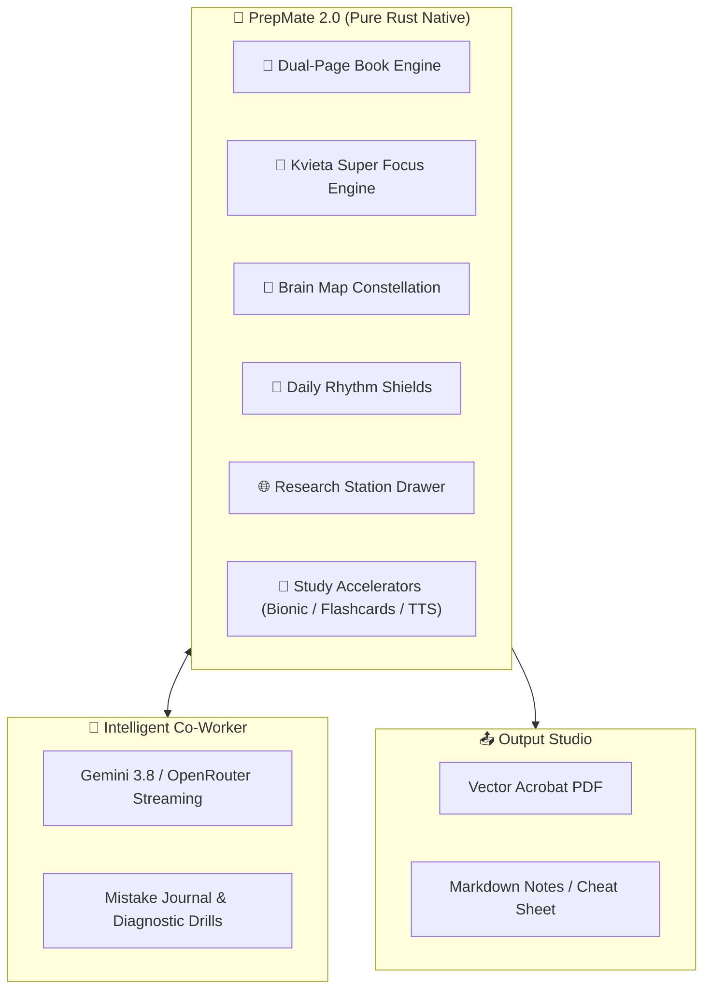

<div align="center">

# 🎓 PrepMate
### *Autonomous AI Study Studio (PrepMate 2.0) & PDF Workbook Solver*

<p align="center">
  <b>English</b> &nbsp;|&nbsp; <a href="README_TR.md">Türkçe</a>
</p>

[](https://github.com/Rel0adediso/Prepmate-PDF/releases/latest)
[](https://www.rust-lang.org/)
[](#)
[](https://python.org)
[](https://aistudio.google.com)
[](#)

<p align="center">
  Next-generation personal study studio and autonomous AI workbook solver.<br/>
  Featuring <b>PrepMate 2.0</b>: a <b>2.4 MB pure native Rust desktop app</b> with Kvieta focus engine, Brain Map, dual-page book spreads, and <b>Acrobat-grade vector PDF</b> solutions.
</p>

<p align="center">
  <a href="https://github.com/Rel0adediso/Prepmate-PDF/releases/latest/download/PrepMate-2.0.exe">
    
  </a>
  &nbsp;&nbsp;
  <a href="https://github.com/Rel0adediso/Prepmate-PDF/releases/latest/download/PrepMate-PDF.exe">
    
  </a>
</p>

</div>

---

## ⚡ Which Version to Choose?

| Edition | Architecture | Binary Size | Startup | Key Strengths |
| :--- | :--- | :---: | :---: | :--- |
| **PrepMate 2.0** *(Recommended)* | **Pure Rust (`wry` + `tao`)** | **2.40 MB** | **<30 ms** | Kvieta Super Focus, Brain Map mastery graph, Daily Rhythm Shields, Research Station, Bionic Reading, 3D Flashcards, dual-page book reader, zero dependencies. |
| **PrepMate Classic** | Python 3.10+ & FastAPI | ~60 MB | ~2 s | Deep vector PDF parser, full page handwriting injection, CEFR level calibrator, Acrobat vector compiler. |

---

## 🌟 PrepMate 2.0 — Key Innovations

### 🎯 1. Kvieta Super Focus Engine
Inspired by the gentle, non-punitive focus architecture of **Kvieta** (`Rel0adediso/Kvieta-app`):
- **Session Intentions (`FocusIntention`):** Set what you will accomplish before diving in (*e.g., "Calculus Pages 12-15 exercises"*).
- **68px Ambient HUD (`SessionSurface`):** Unobtrusive top bar displaying current focus goal, timer, and smooth progress tracking.
- **Gentle Closure Warnings:** Calm 5-minute and 1-minute reminders to wrap up your thoughts without panic.
- **Focus Closure Summary:** Captures completed intentions, logged pages, and commits them to the daily rhythm log.

### 🧠 2. Brain Map (Constellation Mastery Radar)
- **Interactive SVG Constellation:** Dynamic subject nodes generated from your uploaded curriculum.
- **Mastery Levels:** 🟢 Mastered (>75%), 🟡 Needs Review (50-74%), 🔴 Critical Weakness (<50%).
- **Mistake Journal Synchronization:** Tracks unresolved errors per unit in real time.
- **⚡ Targeted Weakness Drill:** 1-click Co-Worker prompt creating a 2-sentence concept rule and a targeted trap question.

### 📅 3. Daily Study Plan & Rhythm Shields
- Daily auto-advancing tasks: Reading pages, completing focus blocks, solving mistakes.
- **Rhythm Shields (`🛡️ 2 Shields`):** Protects your streak when life gets busy.

### 🌐 4. Research Station (In-App Study Browser)
- Slide-over drawer with instant access to academic references:
  - 🇹🇷 **Tureng** & 🇬🇧 **Cambridge Dictionary** (Bilingual definitions)
  - 📈 **Desmos** (Interactive graphing calculator)
  - 📚 **Wikipedia** & 🔍 **DuckDuckGo**
- **1-Click Text Lookup:** Select any word or passage in the book to search instantly.
- **Native OS Browser Bridge:** Clean handoff for protected sites via Windows default browser.

### 🚀 5. Study Accelerators
- **🔤 Bionic Reading:** Bolds the initial 45% of words to guide eye fixations and double reading speed.
- **🃏 3D Flipping Flashcards:** Spatial flip animations (`preserve-3d`) auto-populated from your personal Mistake Journal.
- **🔊 Text-to-Speech (TTS):** Natural speech synthesis in English and Turkish via Web Speech API.
- **🎯 Exam Countdown HUD:** Real-time day counter and remaining page target on the welcome dashboard.

### 📖 6. Dual-Page Editorial Book Reader
- Two-page spread with center spine shadow (`spine crease`).
- Paper modes: **Dark Charcoal** (`#1c1b18`), **Warm Sepia** (`#25201a`), and **Crisp White**.
- Raycast-style command palette (`Ctrl + K`), Notion-style margin notes, and ambient rain/library focus audio.

---

## 🛠️ Architecture Overview



---

## ⌨️ Keyboard Shortcuts

| Shortcut | Action |
| :---: | :--- |
| `Ctrl + K` | Open Raycast Command Palette (Omnibar) |
| `Ctrl + D` / `F11` | Toggle Zen & Fullscreen Focus Mode |
| `Ctrl + Z` | Undo last edit |
| `Ctrl + Y` | Redo undone edit |
| `←` / `→` | Previous / Next page spread |
| `Escape` | Close active modals (Research Drawer, Focus Summary) |

* **🎨 Warm Obsidian & Terracotta Aesthetic:** Editorial typography (`Newsreader` serif), warm accents, and an eye-soothing dark canvas.
* **🌙 Eye-Care Parchment Mode:** Softens harsh white textbook glare into warm vintage parchment during late-night study hours.
* **📋 Rapid Cheat Sheet (Answer Key):** Clean numbered list (`#1`, `#2`, ...) of every solution on the active page for instant copying.
* **📸 1-Click Clipboard Image Copy:** Exports full resolved high-dpi page image directly to clipboard for pasting into WhatsApp Web or Discord (`Ctrl+V`).
* **🎭 Natural Student Mode (~95% Score):** Realistic student behavior mode that avoids robotic perfection, preventing teacher AI detection.
* **🎯 CEFR Difficulty Tuning (A1 - C1):** Calibrate vocabulary and grammatical complexity specifically to your course syllabus.
* **🧠 Mind-Map & Sunburst Solver:** Accurately fills radial bubble diagrams, concept maps, and category trees.
* **✍️ 5.8pt Supralinear Corrections:** Overwrites typos cleanly above crossed-out words without text collisions.

---

## 💻 Step-by-Step Usage Guide

1. **Load Your Workbook:** Drag & drop your PDF file or click *"🎯 Try Sample Homework"*.
2. **Configure Pages & Level:** Enter page range *(e.g., `12-18`)*, select your CEFR proficiency level, and toggle *Natural Student Mode* if desired.
3. **Solve Automatically:** Click *"⚡ Fetch Pages & Solve"*. Fast concurrent workers process all selected pages in seconds.
4. **Review & Fine-Tune:**
   - Drag answer text boxes with your mouse or double-click to edit content directly.
   - Use `Ctrl + Z` to undo or `Ctrl + Y` to redo any edits.
   - Enable `🌙 Parchment Mode` for relaxed viewing.
   - Click `📋 Cheat Sheet` for a quick text answer overview.
5. **Export Your Results:**
   - **📄 Download Homework Only:** Compiles only the assigned solved pages into a clean, ready-to-submit PDF.
   - **📚 Download Full Book:** Injects solutions into the full textbook while leaving untouched pages intact.
   - **📸 Copy Page Image:** Copies high-resolution visual directly to clipboard (`Ctrl+V`).

---

## ⌨️ Keyboard Shortcuts

| Shortcut | Action |
| :---: | :--- |
| `Ctrl + Z` | Undo last change |
| `Ctrl + Y` / `Ctrl + Shift + Z` | Redo undone change |
| `←` / `→` | Navigate to previous / next page |
| `Delete` / `Backspace` | Delete selected solution box |
| `Escape` | Deselect box / Close open modals (Cheat Sheet, API Key) |

---

## 👨‍💻 For Developers (Running from Source)

### 🦀 Building PrepMate 2.0 (Pure Rust Native)
```bash
# Prerequisites: Rust toolchain (stable-x86_64-pc-windows-gnu or msvc)
cd prepmate-core

# Run in development
cargo run

# Compile ultra-compact release executable (2.4 MB)
cargo build --release
```

### 🐍 Running PrepMate Classic (Python / FastAPI)
```bash
# 1. Clone repository
git clone https://github.com/Rel0adediso/Prepmate-PDF.git
cd Prepmate-PDF

# 2. Install dependencies (or run kurulum.bat)
pip install -r requirements.txt

# 3. Launch app (or run baslat.bat)
python desktop.py
```

To compile a standalone single-file Windows executable:
```bash
derle_exe.bat
```

---

## 🛡️ Privacy & Security Guarantee (100% Local-First)

* **Zero Cloud Storage:** PDFs and generated solutions are processed locally (`localhost`). Nothing is uploaded or stored on external servers.
* **Encrypted Local Storage:** API keys are stored locally on your device only and are never committed to git or sent to third parties.
* **Fully Open Source:** No telemetry, tracking, or background analytics.

---

<div align="center">
  <sub>PrepMate PDF — Open Source Workbook Companion • MIT License</sub>
</div>
