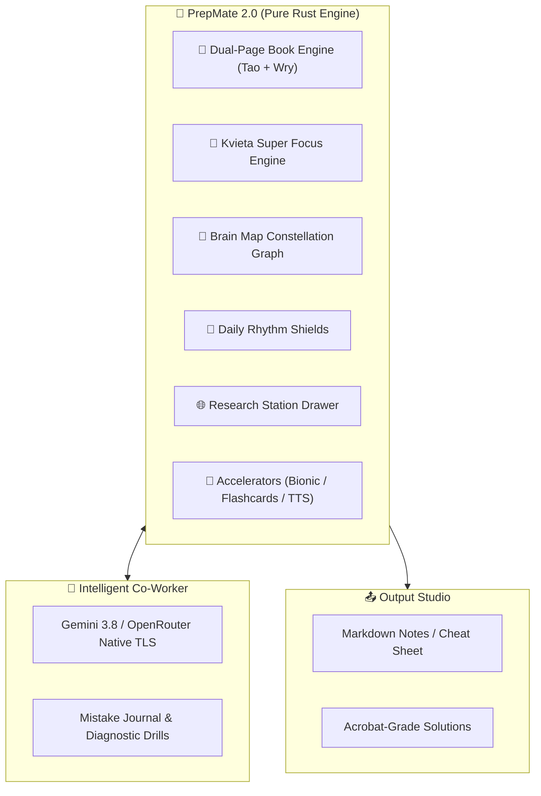

<div align="center">

# 🎓 PrepMate 2.0
### *Next-Generation Autonomous AI Study Studio & Editorial Book Reader*

<p align="center">
  <b>English</b> &nbsp;|&nbsp; <a href="README_TR.md">Türkçe</a>
</p>

[](https://github.com/Rel0adediso/Prepmate-PDF/releases/latest)
[](https://www.rust-lang.org/)
[](#)
[](#)
[](https://aistudio.google.com)
[](#)

<p align="center">
  A <b>pure native Rust</b> desktop studio crafted for deep learning, textbook study, and homework problem solving.<br/>
  Featuring the <b>Kvieta Super Focus Engine</b>, <b>Brain Map Constellation</b>, <b>Research Station</b>, and <b>dual-page editorial book spreads</b>.
</p>

<p align="center">
  <a href="https://github.com/Rel0adediso/Prepmate-PDF/releases/download/v2.0.0-alpha.1/PrepMate-2.0-Alpha-1.exe">
    
  </a>
</p>

</div>

---

## ⚡ Why PrepMate 2.0 (Pure Rust Native)?

| Feature | Typical Web/Electron Apps | 🦀 PrepMate 2.0 Native |
| :--- | :---: | :---: |
| **Download & Memory Size** | 200 MB - 600 MB (heavy Chromium) | **2.40 MB ultra-compact standalone binary** |
| **Startup Latency** | 2 - 5 seconds | **<30 milliseconds (instant GPU draw)** |
| **Runtime Dependencies** | Python, Node.js, Electron, Uvicorn | **Zero runtime dependencies (pure native Rust)** |
| **Focus Philosophy** | Distracting gamification | **Kvieta gentle, non-punitive focus engine** |
| **Curriculum Mastery** | Linear progress bars | **Brain Map dynamic SVG constellation graph** |
| **Reading Experience** | Flat, glaring single-page PDF | **2-page editorial book spread with paper modes** |
| **Academic Research** | Constant tab switching | **Slide-over Research Station drawer (Tureng, Desmos, etc.)** |
| **Reading Speed** | Standard text | **Bionic Reading toggle (2x faster comprehension)** |
| **Mistake Retention** | Forgotten errors | **Auto-sync Mistake Journal & 3D flipping flashcards** |

---

## 🌟 Core Superpowers

### 🎯 1. Kvieta Super Focus Engine
Inspired by the gentle, non-punitive focus architecture of **Kvieta** (`Rel0adediso/Kvieta-app`):
- **Session Intentions (`FocusIntention`):** Set what you will accomplish before diving in (*e.g., "Calculus Pages 12-15 integrals"*).
- **68px Ambient HUD (`SessionSurface`):** Unobtrusive top bar displaying active focus target, countdown timer, and soft progress tracking.
- **Gentle Closure Reminders:** Calm 5-minute and 1-minute audio/visual notifications to wrap up your thoughts without panic.
- **Focus Closure Summary:** Captures completed intentions, logged pages, and commits them to your daily rhythm log.

### 🧠 2. Brain Map (Constellation Mastery Radar)
- **Dynamic SVG Constellation:** Automatically maps your uploaded textbook units into interactive knowledge nodes.
- **Mastery Levels:** 🟢 Mastered (>75%), 🟡 Needs Review (50-74%), 🔴 Critical Weakness (<50%).
- **Mistake Journal Synchronization:** Tracks unresolved errors per unit in real time.
- **⚡ Targeted Weakness Drill:** 1-click Co-Worker prompt creating a 2-sentence concept rule and a targeted trap question.

### 📅 3. Daily Study Plan & Rhythm Shields
- Daily auto-advancing tasks: Reading pages, completing focus blocks, solving mistakes.
- **Rhythm Shields (`🛡️ 2 Shields`):** Protects your daily streak when life gets busy.

### 🌐 4. Research Station (Slide-over Study Browser)
- Slide-over drawer with instant access to academic references:
  - 🇹🇷 **Tureng** & 🇬🇧 **Cambridge Dictionary** (Bilingual definitions)
  - 📈 **Desmos** (Interactive graphing calculator)
  - 📚 **Wikipedia** & 🔍 **DuckDuckGo**
- **1-Click Text Lookup:** Select any word in the book to search instantly.
- **Native OS Browser Bridge:** Clean handoff for protected sites via Windows default browser.

### 🚀 5. Study Accelerators
- **🔤 Bionic Reading:** Bolds the initial 45% of words to guide eye fixations and double reading speed.
- **🃏 3D Flipping Flashcards:** Spatial flip animations (`preserve-3d`) auto-populated from your personal Mistake Journal.
- **🔊 Text-to-Speech (TTS):** Natural speech synthesis in English and Turkish via Web Speech API.
- **🎯 Exam Countdown HUD:** Real-time day counter and remaining page target on the welcome dashboard.

### 📖 6. Dual-Page Editorial Book Reader
- Two-page spread with center spine shadow (`spine crease`).
- Paper modes: **Dark Charcoal** (`#1c1b18`), **Warm Sepia** (`#25201a`), and **Crisp White**.
- Raycast-style command palette (`Ctrl + K`), Notion-style margin notes, and ambient rain/library focus audio.

---

## 🛠️ Architecture



---

## ⌨️ Keyboard Shortcuts

| Shortcut | Action |
| :---: | :--- |
| `Ctrl + K` | Open Raycast Command Palette (Omnibar) |
| `Ctrl + D` / `F11` | Toggle Zen & Fullscreen Focus Mode |
| `Ctrl + Z` | Undo last edit |
| `Ctrl + Y` | Redo undone edit |
| `←` / `→` | Previous / Next page spread |
| `Escape` | Close active modals (Research Drawer, Focus Summary) |

---

## 🚀 Quick Start in 10 Seconds

> **No coding, Python installation, or command-line steps required!**
> 1. Download **[`PrepMate-2.0-Alpha-1.exe`](https://github.com/Rel0adediso/Prepmate-PDF/releases/download/v2.0.0-alpha.1/PrepMate-2.0-Alpha-1.exe)**.
> 2. Double-click the file to launch.
> 3. Click **"⚙️ Ayarlar"** and paste your free key from [Google AI Studio](https://aistudio.google.com/app/apikey).

---

## 👨‍💻 For Developers (Building from Source)

```bash
# 1. Clone repository
git clone https://github.com/Rel0adediso/Prepmate-PDF.git
cd Prepmate-PDF

# 2. Run in development mode
cargo run

# 3. Build ultra-compact release executable (2.40 MB)
cargo build --release
```

Windows batch shortcuts are also included:
- `baslat.bat` — runs the application in release mode.
- `derle.bat` — compiles the production binary.

---

## 🛡️ Privacy & Security Guarantee (100% Local-First)

* **Zero Cloud Storage:** PDFs and notes stay on your local disk.
* **Encrypted Local Storage:** API keys are stored locally on your machine and never transmitted anywhere except directly to Google AI Studio via TLS.
* **Fully Open Source:** No telemetry, tracking, or background analytics.

---

> 📌 *Looking for the legacy Python 1.x version? It is permanently preserved in the [`legacy-python-v1`](https://github.com/Rel0adediso/Prepmate-PDF/tree/legacy-python-v1) branch.*

<div align="center">
  <sub>PrepMate 2.0 — Open Source Study Studio • MIT License</sub>
</div>
