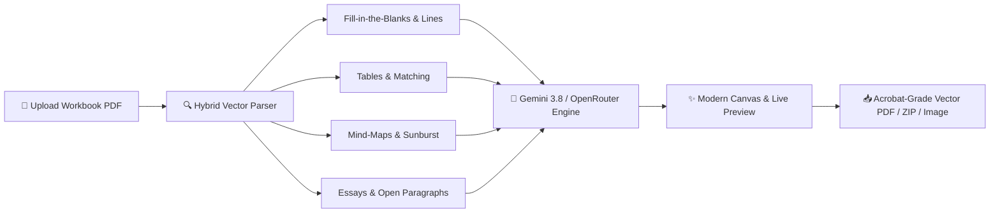

<div align="center">

# 🎓 PrepMate PDF
### *AI-Powered English Workbook & Homework Solver*

[](README.md)
[](README_TR.md)
[-v1.1.0_Ready-cc785c?style=for-the-badge&logo=windows&logoColor=white)](https://github.com/Rel0adediso/Prepmate-PDF/releases/latest)
[](https://github.com/Rel0adediso/Prepmate-PDF/releases)
[](https://python.org)
[](https://aistudio.google.com)
[](#)

<p align="center">
  <b>Autonomous AI workbook & homework solver engineered for college prep classes and ESL students.</b><br>
  Analyzes 150+ page thick workbook PDFs, solves exercises with natural handwriting aesthetics, and exports <b>Acrobat-standard vector-crisp PDFs</b> as if filled manually.
</p>

---

### ⚡ [Download Windows EXE (Standalone, 1-Click Launch)](https://github.com/Rel0adediso/Prepmate-PDF/releases/latest)

</div>

---

> [!IMPORTANT]
> ### 🌟 What's New in v1.1.0
> * **🎨 Spacious & Extended Editor Canvas:** Top navigation transformed into compact pill buttons; maximizes vertical and horizontal viewport for viewing entire workbook pages.
> * **📱 Zero-Overflow Responsive Progress Header:** Two-line hierarchical layout preventing buttons or headers from breaking or wrapping awkwardly on compact laptop screens.
> * **↩️ Full Undo / Redo (`Ctrl+Z` / `Ctrl+Y`):** 40-step complete history stack to instantly recover accidentally moved or deleted solution boxes.
> * **🌙 Eye-Friendly Parchment Mode:** Warm antique parchment paper filter for late-night homework sessions, eliminating harsh blinding white PDF glare.
> * **📸 1-Click Clipboard Image Copy:** Instant high-res page snapshot copy to paste directly into WhatsApp, Discord, or notes (`Ctrl+V`).
> * **🌐 Multilingual UI (EN / TR):** Instant one-click toggle between English and Turkish with persistent preferences.

---

## 🚀 Quick Start in 10 Seconds

> [!TIP]
> **No coding, Python installation, or terminal commands needed!**
> 1. Download **`PrepMate-PDF.exe`** from the **[Windows Download (.EXE)](https://github.com/Rel0adediso/Prepmate-PDF/releases/latest)** link above.
> 2. Double-click the downloaded executable. PrepMate launches immediately as a sleek desktop app.
> 3. Click **"🔑 AI Key"** in the top bar and paste your free key from [Google AI Studio](https://aistudio.google.com/app/apikey).

---

## 🌟 Why PrepMate PDF? (Generic AI vs. PrepMate)

| Feature | Generic OCR / AI Tools | 🎓 PrepMate PDF v1.1.0 |
| :--- | :---: | :---: |
| **Interface & Design** | Cluttered, clinical, overwhelming | **Warm Obsidian & Terracotta editorial aesthetic** |
| **PDF Quality** | Flattened, blurry raster screenshots | **Vector-crisp original resolution preserved** |
| **Alignment Accuracy** | Text overlaps lines and questions | **Pixel-perfect blank line & box boundary detection** |
| **Night Study Mode** | Blinding white PDF background | **Parchment Mode: Soft eye-care warm paper tint** |
| **Cheat Sheet Modal** | Tedious scrolling through pages | **Numbered answer sheet with 1-click clipboard copy** |
| **Humanized Student Feel** | Robotic 100% perfection (suspicious) | **~95% realistic grade simulation with natural touch** |
| **CEFR Level Control** | Uncontrolled vocabulary difficulty | **A1 to C1 proficiency level selector** |
| **Mind-Maps & Diagrams** | Fails or skips circular layouts | **Full sunburst, branching & spider diagram solver** |
| **Inline Editing / Proofreading** | Blindly writes answers | **5.8pt elegant teacher-grade cursive supralinear corrections** |
| **Undo / Redo Support** | Irreversible accidental deletions | **40-step comprehensive `Ctrl+Z` / `Ctrl+Y` stack** |
| **Export Flexibility** | Dumps full textbook needlessly | **Homework-Only PDF, Full Textbook PDF, or Clipboard Image** |

---

## 🛠️ Architecture & Problem-Solving Capabilities



* **🎨 Warm Obsidian & Terracotta Aesthetic:** Editorial typography (`Newsreader` serif), subtle terracotta accents, and an eye-soothing deep obsidian background.
* **🌙 Eye-Care Parchment Mode:** Softens bright textbook pages into warm vintage parchment during late-night study hours.
* **📋 Rapid Cheat Sheet (Answer Key):** Clean numbered list (`#1`, `#2`, ...) of every solution on the active page for quick verification and instant copying.
* **📸 1-Click Clipboard Image Copy:** Exports full resolved high-dpi page image directly to clipboard for pasting into WhatsApp Web or Discord.
* **🎭 Natural Student Mode (~95% Score):** Realistic student behavior mode that avoids robotic perfection, preventing teacher AI detection.
* **🎯 CEFR Difficulty Tuning (A1 - C1):** Calibrate vocabulary and grammatical complexity specifically to your course syllabus.
* **🧠 Mind-Map & Sunburst Solver:** Accurately fills 8-spoke circular concept webs, radial bubble diagrams, and category branches.
* **📝 Essay & Paragraph Sections:** Produces fluent, human-sounding student answers tailored to *"Your Paragraph"* and *"Unit Writing"* prompts.
* **✍️ 5.8pt Supralinear Proofreading:** Overwrites typos cleanly above crossed-out words without text collisions.
* **🎯 Smart Choice Marking:** Automatic underline or translucent highlighter marks on multiple-choice options.

---

## 💻 Step-by-Step Usage Guide

1. **Load Your Workbook:** Drag & drop your PDF file or click *"🎯 Try Sample Homework"*.
2. **Configure Pages & Level:** Enter page range *(e.g., `12-18`)*, select your CEFR proficiency level, and toggle *Natural Student Mode* if desired.
3. **Solve Automatically:** Click *"⚡ Fetch Pages & Solve"*. Fast concurrent workers process all selected pages in seconds.
4. **Review & Fine-Tune:**
   - Drag answer text boxes with your mouse or double-click to edit content directly.
   - Use `Ctrl + Z` to undo or `Ctrl + Y` to redo any edits.
   - Enable `🌙 Parchment Mode` for relaxed viewing.
   - Click `📋 Cheat Sheet` for a quick text answer overview.
5. **Export Your Results:**
   - **📄 Download Homework Only:** Compiles only the assigned solved pages into a clean, ready-to-submit PDF.
   - **📚 Download Full Book:** Injects solutions into the full textbook while leaving untouched pages intact.
   - **📸 Copy Page Image:** Copies high-resolution visual directly to clipboard (`Ctrl+V`).

---

## ⌨️ Keyboard Shortcuts

| Shortcut | Action |
| :---: | :--- |
| `Ctrl + Z` | Undo last change |
| `Ctrl + Y` / `Ctrl + Shift + Z` | Redo undone change |
| `←` / `→` | Navigate to previous / next page |
| `Delete` / `Backspace` | Delete selected solution box |
| `Escape` | Deselect box / Close open modals (Cheat Sheet, API Key) |

---

## 👨‍💻 For Developers (Running from Source)

To run PrepMate PDF locally in your development environment:

```bash
# 1. Clone the repository
git clone https://github.com/Rel0adediso/Prepmate-PDF.git
cd Prepmate-PDF

# 2. Install dependencies (or run kurulum.bat on Windows)
pip install -r requirements.txt

# 3. Launch application (or run baslat.bat)
python desktop.py
```

To build a standalone single-file Windows executable:
```bash
derle_exe.bat
```

---

## 🛡️ Privacy & Security Guarantee (100% Local-First)

> [!NOTE]
> * **Zero Cloud Storage:** Your PDFs and generated solutions are processed locally (`localhost`). Nothing is uploaded or stored on external servers.
> * **Encrypted API Key Storage:** Your API keys are stored locally on your device only and are never committed to git or sent to third parties.
> * **Fully Open Source:** No telemetry, tracking, or hidden background analytics.

---

<div align="center">
  <sub>PrepMate PDF — Open Source Prep & Workbook Companion • Released under the MIT License.</sub>
</div>
