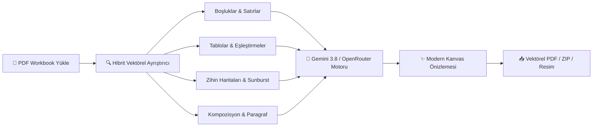

<div align="center">

# 🎓 PrepMate PDF
### *Yapay Zeka Destekli İngilizce Workbook & Ödev Çözücü*

<p align="center">
  <a href="README.md">English</a> &nbsp;|&nbsp; <b>Türkçe</b>
</p>

[](https://github.com/Rel0adediso/Prepmate-PDF/releases/latest)
[](https://github.com/Rel0adediso/Prepmate-PDF/releases)
[](https://python.org)
[](https://aistudio.google.com)
[](#)

<p align="center">
  Üniversite hazırlık sınıfları ve yabancı dil okulları için geliştirilmiş otonom ödev çözücü.<br/>
  Soruları doğal öğrenci el yazısıyla çözer ve <b>Adobe Acrobat vektörel kalitesinde</b> çıktı verir.
</p>

<p align="center">
  <a href="https://github.com/Rel0adediso/Prepmate-PDF/releases/latest/download/PrepMate-PDF.exe">
    
  </a>
</p>

</div>

---

## 🚀 10 Saniyede Başlatma (Hızlı Başlangıç)

> **Kod bilmenize, Python yüklemenize veya terminal açmanıza gerek yoktur!**
> 1. Doğrudan **[Tek Tıkla Windows EXE İndir](https://github.com/Rel0adediso/Prepmate-PDF/releases/latest/download/PrepMate-PDF.exe)** bağlantısından güncel sürümü indirin.
> 2. Çift tıklayarak programı modern masaüstü penceresi olarak başlatın.
> 3. Sağ üstteki **"🔑 AI Anahtarı"** butonuna tıklayıp [Google AI Studio](https://aistudio.google.com/app/apikey)'dan aldığınız ücretsiz anahtarı yapıştırın.

---

## 🌟 Neden PrepMate PDF?

| Özellik | Sıradan OCR / AI Araçları | 🎓 PrepMate PDF |
| :--- | :---: | :---: |
| **Arayüz & Estetik** | Soğuk, karmaşık veya boğucu arayüz | **Sıcak Obsidyen & Terracotta editoryal tasarımı** |
| **PDF Formatı & Kalite** | PDF'i bozar, bulanık resme çevirir | **Vektörel kalitede, orijinal çözünürlük korunur** |
| **Hizalama Hassasiyeti** | Yanıtlar satırların dışına taşar | **Piksel düzeyinde çizgi & kutu tespiti** |
| **Gece Çalışma (Göz Koruma)** | Beyaz PDF parlaması göz yorar | **Parchment Mode: Sıcak parşömen kağıt filtresi** |
| **Hızlı Cevap Kağıdı** | Tek tek sayfada aramak gerekir | **Numaralı tam döküm ve tek tıkla panoya kopyalama** |
| **Öğrenci Doğallığı (Human Touch)**| Robotik kusursuzluk (şüphe çeker) | **~%95 hedef puan, insani öğrenci hata payı simülasyonu** |
| **Dil Seviyesi Kontrolü** | Kontrolsüz zor/kolay kelimeler | **A1 - C1 CEFR seviye seçici** |
| **Zihin Haritası & Diyagramlar** | Okuyamaz veya atlar | **Sunburst & örümcek diyagramlarını tam çözer** |
| **Hata Düzeltme (Editing)** | Sadece kelimeyi yazar | **5.8pt zarif öğretmen el yazısıyla satır üstü düzeltme** |
| **Geri Al / İleri Al Desteği** | Yanlış silinirse geri gelmez | **40 adımlı tam Ctrl+Z / Ctrl+Y geçmişi** |
| **Çıktı Formatı** | Tüm kitabı baştan sona basar | **Ödev PDF'i, Tam Kitap PDF'i veya Pano Resmi (Ctrl+V)** |

---

## 🛠️ Mimari & Çözüm Yetenekleri



* **🎨 Sıcak Obsidyen & Terracotta Teması:** Okuma deneyimini editoryal dergi seviyesine taşıyan serif başlıklar (`Newsreader`), yumuşak kiremit vurgular ve gözü dinlendiren koyu obsidian zemin.
* **🌙 Göz Koruma (Parchment Mode):** Gece laptop başında ödev yetiştirirken bembeyaz PDF parlaklığını kırıp sıcak parşömen filtresine büründüren göz koruma anahtarı.
* **📋 Hızlı Cevap Kağıdı (Cheat Sheet):** Sayfadaki tüm soruları `#1`, `#2` şeklinde sıralı döküm halinde gösteren, tek tıkla kopyalanabilen kompakt cevap anahtarı.
* **📸 Tek Tıkla Resim Kopyalama:** Çözülmüş sayfayı yüksek çözünürlükte doğrudan panoya kopyalayıp WhatsApp Web veya Discord'a yapıştırma (`Ctrl+V`).
* **🎭 Doğal Öğrenci Hissi (~%95 Puan):** Hocanın *"bunu yapay zeka çözmüş"* şüphesini sıfıra indiren, 1-2 küçük masum insani esneme payı bırakan akıllı simülasyon.
* **🎯 CEFR Dil Seviyesi (A1 - C1):** Ödevin ait olduğu hazırlık kuru seviyesine göre dilbilgisini ve kelime haznesini anında ayarlama.
* **🧠 Zihin Haritası & Sunburst (Mind-Map):** Dairesel kavram haritalarını, dairesel sunburst ve örümcek diyagramlarını merkezden dışa doğru doğru açılarla doldurur.
* **✍️ 5.8pt Hata Düzeltme (Editing):** Üstü çizili veya yanlış kelimelerin hemen üzerine metinle çakışmayan temiz düzeltmeler kondurur.

---

## 💻 Kullanım Kılavuzu

1. **Kitabı Yükleyin:** PDF dosyanızı pencereye sürükleyin veya *"🎯 Örnek İngilizce Ödev ile Hemen Dene"* butonuna basın.
2. **Ödev Sayfalarını & Seviyeyi Seçin:** Sayfa aralığını girin *(Örn: `12-18`)*, CEFR seviyenizi belirleyin ve isterseniz *Doğal Öğrenci Modu*nu açın.
3. **Çözdürün:** *"⚡ Sayfaları Getir ve Otomatik Çöz"* butonuna tıklayın. Sayfalar paralel worker'lar ile saniyeler içinde çözülür.
4. **Kontrol Edin & İnce Ayar Yapın:**
   - Cevapları fareyle istediğiniz yere sürükleyin veya üzerine çift tıklayarak metni düzenleyin.
   - Hata yaparsanız `Ctrl + Z` ile geri alın veya `Ctrl + Y` ile ileri alın.
   - Gece çalışıyorsanız `🌙 Göz Koruma` modunu açarak ekranı yumuşatın.
   - Hızlıca cevapları kontrol etmek için `📋 Cevaplar` butonunu kullanın.
5. **Dışa Aktarın:**
   - **📄 Sadece Ödev Sayfalarını İndir:** Hocanıza teslim etmelik derli toplu tek bir PDF üretir.
   - **📚 Tüm Kitabı İndir:** Tüm çalışma kitabının ilgili sayfalarını doldurup tam kitap olarak verir.
   - **📸 Resim Kopyala:** Doğrudan panoya kopyalayıp WhatsApp veya notlarınıza yapıştırın.

---

## ⌨️ Klavye Kısayolları

| Kısayol | Açıklama |
| :---: | :--- |
| `Ctrl + Z` | Son işlemi geri al (Undo) |
| `Ctrl + Y` / `Ctrl + Shift + Z` | Geri alınan işlemi ileri al (Redo) |
| `←` / `→` | Önceki / Sonraki sayfaya hızlı geçiş |
| `Delete` / `Backspace` | Seçili cevap kutusunu anında sil |
| `Escape` | Seçimi kaldır / Açık pencereleri (Cevap Kağıdı, API Modalı) kapat |

---

## 👨‍💻 Geliştiriciler İçin (Kaynak Koddan Çalıştırma)

```bash
# 1. Depoyu klonlayın
git clone https://github.com/Rel0adediso/Prepmate-PDF.git
cd Prepmate-PDF

# 2. Gereksinimleri yükleyin (veya kurulum.bat dosyasını çalıştırın)
pip install -r requirements.txt

# 3. Uygulamayı başlatın (veya baslat.bat dosyasını çalıştırın)
python desktop.py
```

Tek dosyalı EXE derlemek için:
```bash
derle_exe.bat
```

---

## 🛡️ Gizlilik & Güvenlik Garantisi (%100 Yerel)

* **Sıfır Bulut Kaydı:** Yüklediğiniz PDF'ler ve oluşturulan çözümler yalnızca kendi bilgisayarınızda (`localhost`) işlenir. Harici hiçbir sunucuya kaydedilmez.
* **Güvenli API Anahtarı Saklama:** Girdiğiniz API anahtarları yalnızca kendi cihazınızda şifreli/yerel olarak saklanır; GitHub reposuna veya üçüncü şahıslara asla iletilmez.
* **Açık Kaynak Kod:** Kod tabanında hiçbir telemetri, arka kapı veya kullanıcı takip kodu bulunmaz.

---

<div align="center">
  <sub>PrepMate PDF — Açık Kaynaklı Hazırlık & Workbook Asistanı • MIT Lisansı ile korunmaktadır.</sub>
</div>
