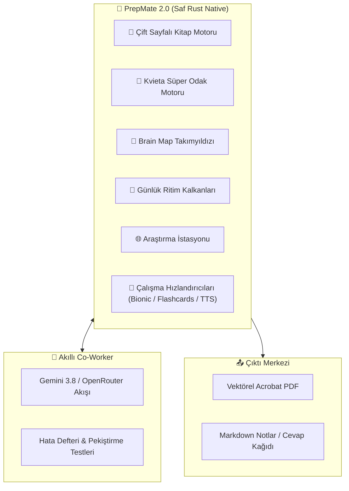

<div align="center">

# 🎓 PrepMate
### *Otonom Yapay Zeka Çalışma Stüdyosu (PrepMate 2.0) & PDF Ödev Çözücü*

<p align="center">
  <a href="README.md">English</a> &nbsp;|&nbsp; <b>Türkçe</b>
</p>

[](https://github.com/Rel0adediso/Prepmate-PDF/releases/latest)
[](https://www.rust-lang.org/)
[](#)
[](https://python.org)
[](https://aistudio.google.com)
[](#)

<p align="center">
  Yeni nesil kişisel çalışma stüdyosu ve otonom yapay zeka ödev çözücü.<br/>
  <b>PrepMate 2.0</b>: <b>2.4 MB saf Rust yerel masaüstü uygulaması</b>, Kvieta odak motoru, Brain Map takımyıldızı, çift sayfalı kitap açılımı ve <b>Adobe Acrobat vektörel kalitesinde</b> çözümler.
</p>

<p align="center">
  <a href="https://github.com/Rel0adediso/Prepmate-PDF/releases/latest/download/PrepMate-2.0.exe">
    
  </a>
  &nbsp;&nbsp;
  <a href="https://github.com/Rel0adediso/Prepmate-PDF/releases/latest/download/PrepMate-PDF.exe">
    
  </a>
</p>

</div>

---

## ⚡ Hangi Sürümü Seçmelisiniz?

| Sürüm | Mimari | Dosya Boyutu | Açılış Hızı | Öne Çıkan Güçlü Yönler |
| :--- | :--- | :---: | :---: | :--- |
| **PrepMate 2.0** *(Önerilen)* | **Saf Rust (`wry` + `tao`)** | **2.40 MB** | **<30 ms** | Kvieta Süper Odak Motoru, Brain Map konu hakimiyet grafiği, Günlük Ritim Kalkanları, Araştırma İstasyonu, Bionic Reading, 3D Hafıza Kartları, çift sayfalı kitap okuyucu, sıfır bağımlılık. |
| **PrepMate Klasik** | Python 3.10+ & FastAPI | ~60 MB | ~2 sn | Derin vektörel PDF ayrıştırma, tam sayfa doğal el yazısı basımı, CEFR seviye ayarı, Acrobat vektörel derleme. |

---

## 🌟 PrepMate 2.0 — Çığır Açan Yenilikler

### 🎯 1. Kvieta Süper Odak Motoru (Super Focus Engine)
**Kvieta** projesinin (`Rel0adediso/Kvieta-app`) sakin ve cezalandırıcı olmayan mimarisinden esinlenildi:
- **Odak Niyeti Belirleme (`FocusIntention`):** Çalışmaya başlamadan önce hedefini yaz (*ör. "Kalkülüs Syf 12-15 integral alıştırmaları"*).
- **68px Hafif HUD (`SessionSurface`):** Sayfa üstünde dikkat dağıtmayan niyet bandı, sayaç ve yumuşak ilerleme çubuğu.
- **Nazik Kapanış Uyarıları:** 5 dakika ve 1 dakika kala sakinleştirici, toparlanma bildirimleri.
- **Oturum Kapanış Özeti:** Tamamlanan niyetler, okunan sayfa sayısı ve günlük ritim kütüğü.

### 🧠 2. Brain Map (Konu Hakimiyeti Takımyıldızı)
- **İnteraktif SVG Takımyıldızı:** Yüklenen ders müfredatından dinamik konu düğümleri.
- **Hakimiyet Seviyeleri:** 🟢 Güçlü (>%75), 🟡 Tekrar Gerekli (%50-74), 🔴 Kritik Zayıf Nokta (<%50).
- **Hata Defteri Entegrasyonu:** Her konudaki çözülmemiş yanlışların anlık takibi.
- **⚡ Zayıf Noktayı Pekiştir:** Tek tıkla 2 cümlelik pratik özet kural ve tuzaklı pekiştirme sorusu sunan Co-Worker antrenmanı.

### 📅 3. Günlük Çalışma Planı & Ritim Kalkanları
- Günlük görevler: Sayfa okuma, odak seansı tamamlama, yanlışları pekiştirme.
- **Ritim Kalkanları (`🛡️ 2 Kalkan`):** Yoğun günlerde seriyi korur.

### 🌐 4. Araştırma İstasyonu (Study Browser)
- Çalışma masasından ayrılmadan kayar çekmeceden açılan akademik kaynaklar:
  - 🇹🇷 **Tureng** & 🇬🇧 **Cambridge Dictionary**
  - 📈 **Desmos** (Grafik çizici)
  - 📚 **Wikipedia** & 🔍 **DuckDuckGo**
- **Metin Seçiminden Hızlı Arama:** Kitapta seçilen herhangi bir kelime anında araştırılır.
- **İşletim Sistemi Tarayıcı Köprüsü:** Güvenlikli siteler için tek tıkla Windows varsayılan tarayıcısına yönlendirme.

### 🚀 5. Çalışma Hızlandırıcıları
- **🔤 Bionic Reading:** Kelimelerin ilk %45'lik harflerini vurgulayarak okuma hızını 2 katına çıkarır.
- **🃏 3D Hafıza Kartları (Flashcards):** Gerçek 3D döndürme animasyonu (`preserve-3d`) ve Hata Defteri'nden otomatik kart türetme.
- **🔊 Sesli Okuma (TTS):** Doğal Türkçe ve İngilizce telaffuz ile Web Speech API seslendirmesi.
- **🎯 Sınav Geri Sayım HUD:** Karşılama ekranında hedeflenen sınav tarihine kalan gün sayacı.

### 📖 6. Çift Sayfalı Editoryal Kitap Okuyucu
- Masada gerçek bir kitap gibi 2 sayfa yan yana (`Book Spread`) ve dikiş gölgesi (`spine crease`).
- Kağıt modları: **Koyu Kömür** (`#1c1b18`), **Sıcak Sepya** (`#25201a`) ve **Orijinal Beyaz**.
- Raycast tarzı komut paleti (`Ctrl + K`), kenar notları iğneleri ve odaklanma ambiyans sesleri (yağmur/kütüphane).

---

## 🛠️ Mimari Genel Bakış



---

## ⌨️ Klavye Kısayolları

| Kısayol | İşlev |
| :---: | :--- |
| `Ctrl + K` | Raycast Komut Paletini (Omnibar) Aç |
| `Ctrl + D` / `F11` | Zen & Tam Ekran Odaklanma Modunu Aç/Kapat |
| `Ctrl + Z` | Son Değişikliği Geri Al |
| `Ctrl + Y` | Geri Alınan Değişikliği İleri Al |
| `←` / `→` | Önceki / Sonraki Sayfa Çifti |
| `Escape` | Açık Pencereleri Kapat (Araştırma İstasyonu, Kapanış Özeti) |

---

## 👨‍💻 Geliştiriciler İçin (Kaynaktan Çalıştırma)

### 🦀 PrepMate 2.0'ı Derleme (Saf Rust Native)
```bash
# Gereksinim: Rust araç zinciri (stable-x86_64-pc-windows-gnu veya msvc)
cd prepmate-core

# Geliştirme modunda çalıştır
cargo run

# Ultra kompakt sürüm derle (2.4 MB)
cargo build --release
```

### 🐍 PrepMate Klasik'i Çalıştırma (Python / FastAPI)
```bash
# 1. Repoyu klonla
git clone https://github.com/Rel0adediso/Prepmate-PDF.git
cd Prepmate-PDF

# 2. Bağımlılıkları kur (veya kurulum.bat çalıştır)
pip install -r requirements.txt

# 3. Uygulamayı başlat (veya baslat.bat çalıştır)
python desktop.py
```
flowchart LR
    A["📄 PDF Workbook Yükle"] --> B["🔍 Hibrit Vektörel Ayrıştırıcı"]
    B --> C1["Boşluklar & Satırlar"]
    B --> C2["Tablolar & Eşleştirmeler"]
    B --> C3["Zihin Haritaları & Sunburst"]
    B --> C4["Kompozisyon & Paragraf"]
    C1 & C2 & C3 & C4 --> D["🧠 Gemini 3.8 / OpenRouter Motoru"]
    D --> E["✨ Modern Kanvas Önizlemesi"]
    E --> F["📥 Vektörel PDF / ZIP / Resim"]
```

* **🎨 Sıcak Obsidyen & Terracotta Teması:** Okuma deneyimini editoryal dergi seviyesine taşıyan serif başlıklar (`Newsreader`), yumuşak kiremit vurgular ve gözü dinlendiren koyu obsidian zemin.
* **🌙 Göz Koruma (Parchment Mode):** Gece laptop başında ödev yetiştirirken bembeyaz PDF parlaklığını kırıp sıcak parşömen filtresine büründüren göz koruma anahtarı.
* **📋 Hızlı Cevap Kağıdı (Cheat Sheet):** Sayfadaki tüm soruları `#1`, `#2` şeklinde sıralı döküm halinde gösteren, tek tıkla kopyalanabilen kompakt cevap anahtarı.
* **📸 Tek Tıkla Resim Kopyalama:** Çözülmüş sayfayı yüksek çözünürlükte doğrudan panoya kopyalayıp WhatsApp Web veya Discord'a yapıştırma (`Ctrl+V`).
* **🎭 Doğal Öğrenci Hissi (~%95 Puan):** Hocanın *"bunu yapay zeka çözmüş"* şüphesini sıfıra indiren, 1-2 küçük masum insani esneme payı bırakan akıllı simülasyon.
* **🎯 CEFR Dil Seviyesi (A1 - C1):** Ödevin ait olduğu hazırlık kuru seviyesine göre dilbilgisini ve kelime haznesini anında ayarlama.
* **🧠 Zihin Haritası & Sunburst (Mind-Map):** Dairesel kavram haritalarını, dairesel sunburst ve örümcek diyagramlarını merkezden dışa doğru doğru açılarla doldurur.
* **✍️ 5.8pt Hata Düzeltme (Editing):** Üstü çizili veya yanlış kelimelerin hemen üzerine metinle çakışmayan temiz düzeltmeler kondurur.

---

## 💻 Kullanım Kılavuzu

1. **Kitabı Yükleyin:** PDF dosyanızı pencereye sürükleyin veya *"🎯 Örnek İngilizce Ödev ile Hemen Dene"* butonuna basın.
2. **Ödev Sayfalarını & Seviyeyi Seçin:** Sayfa aralığını girin *(Örn: `12-18`)*, CEFR seviyenizi belirleyin ve isterseniz *Doğal Öğrenci Modu*nu açın.
3. **Çözdürün:** *"⚡ Sayfaları Getir ve Otomatik Çöz"* butonuna tıklayın. Sayfalar paralel worker'lar ile saniyeler içinde çözülür.
4. **Kontrol Edin & İnce Ayar Yapın:**
   - Cevapları fareyle istediğiniz yere sürükleyin veya üzerine çift tıklayarak metni düzenleyin.
   - Hata yaparsanız `Ctrl + Z` ile geri alın veya `Ctrl + Y` ile ileri alın.
   - Gece çalışıyorsanız `🌙 Göz Koruma` modunu açarak ekranı yumuşatın.
   - Hızlıca cevapları kontrol etmek için `📋 Cevaplar` butonunu kullanın.
5. **Dışa Aktarın:**
   - **📄 Sadece Ödev Sayfalarını İndir:** Hocanıza teslim etmelik derli toplu tek bir PDF üretir.
   - **📚 Tüm Kitabı İndir:** Tüm çalışma kitabının ilgili sayfalarını doldurup tam kitap olarak verir.
   - **📸 Resim Kopyala:** Doğrudan panoya kopyalayıp WhatsApp veya notlarınıza yapıştırın.

---

## ⌨️ Klavye Kısayolları

| Kısayol | Açıklama |
| :---: | :--- |
| `Ctrl + Z` | Son işlemi geri al (Undo) |
| `Ctrl + Y` / `Ctrl + Shift + Z` | Geri alınan işlemi ileri al (Redo) |
| `←` / `→` | Önceki / Sonraki sayfaya hızlı geçiş |
| `Delete` / `Backspace` | Seçili cevap kutusunu anında sil |
| `Escape` | Seçimi kaldır / Açık pencereleri (Cevap Kağıdı, API Modalı) kapat |

---

## 👨‍💻 Geliştiriciler İçin (Kaynak Koddan Çalıştırma)

```bash
# 1. Depoyu klonlayın
git clone https://github.com/Rel0adediso/Prepmate-PDF.git
cd Prepmate-PDF

# 2. Gereksinimleri yükleyin (veya kurulum.bat dosyasını çalıştırın)
pip install -r requirements.txt

# 3. Uygulamayı başlatın (veya baslat.bat dosyasını çalıştırın)
python desktop.py
```

Tek dosyalı EXE derlemek için:
```bash
derle_exe.bat
```

---

## 🛡️ Gizlilik & Güvenlik Garantisi (%100 Yerel)

* **Sıfır Bulut Kaydı:** Yüklediğiniz PDF'ler ve oluşturulan çözümler yalnızca kendi bilgisayarınızda (`localhost`) işlenir. Harici hiçbir sunucuya kaydedilmez.
* **Güvenli API Anahtarı Saklama:** Girdiğiniz API anahtarları yalnızca kendi cihazınızda şifreli/yerel olarak saklanır; GitHub reposuna veya üçüncü şahıslara asla iletilmez.
* **Açık Kaynak Kod:** Kod tabanında hiçbir telemetri, arka kapı veya kullanıcı takip kodu bulunmaz.

---

<div align="center">
  <sub>PrepMate PDF — Açık Kaynaklı Hazırlık & Workbook Asistanı • MIT Lisansı ile korunmaktadır.</sub>
</div>
