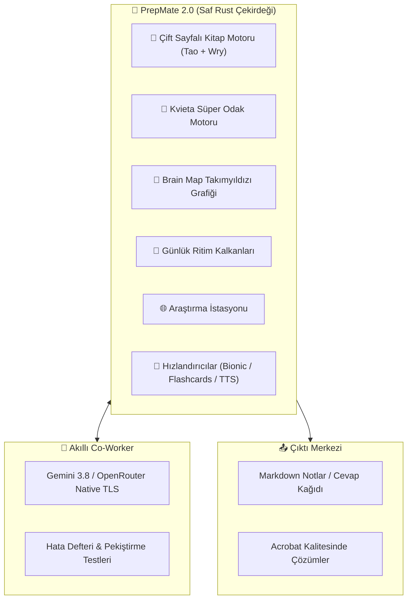

<div align="center">

# 🎓 PrepMate 2.0
### *Yeni Nesil Otonom Yapay Zeka Çalışma Stüdyosu & Editoryal Kitap Okuyucu*

<p align="center">
  <a href="README.md">English</a> &nbsp;|&nbsp; <b>Türkçe</b>
</p>

[](https://github.com/Rel0adediso/Prepmate-PDF/releases/latest)
[](https://www.rust-lang.org/)
[](#)
[](#)
[](https://aistudio.google.com)
[](#)

<p align="center">
  Derinlemesine ders çalışma, kitap okuma ve problem çözme için geliştirilmiş <b>saf Rust</b> masaüstü stüdyosu.<br/>
  <b>Kvieta Süper Odak Motoru</b>, <b>Brain Map Takımyıldızı</b>, <b>Araştırma İstasyonu</b> ve <b>çift sayfalı editoryal kitap açılımı</b>.
</p>

<p align="center">
  <a href="https://github.com/Rel0adediso/Prepmate-PDF/releases/download/v2.0.0-alpha.1/PrepMate-2.0-Alpha-1.exe">
    
  </a>
</p>

</div>

---

## ⚡ Neden PrepMate 2.0 (Saf Rust Native)?

| Özellik | Sıradan Web / Electron Uygulamaları | 🦀 PrepMate 2.0 Native |
| :--- | :---: | :---: |
| **İndirme & RAM Boyutu** | 200 MB - 600 MB (ağır Chromium) | **2.40 MB ultra kompakt bağımsız dosya** |
| **Açılış Hızı** | 2 - 5 saniye bekleme | **<30 milisaniye (anında GPU çizimi)** |
| **Çalışma Bağımlılıkları**| Python, Node.js, Electron, Uvicorn | **Sıfır harici bağımlılık (saf yerel Rust)** |
| **Odaklanma Felsefesi** | Dikkat dağıtan oyunlaştırmalar | **Kvieta sakin ve niyet odaklı mimari** |
| **Müfredat Takibi** | Sıkıcı doğrusal çizgiler | **Brain Map dinamik SVG takımyıldızı** |
| **Okuma Deneyimi** | Göz yoran beyaz tek sayfa | **Çift sayfalı editoryal kitap masası & kağıt tonları** |
| **Akademik Araştırma** | Sürekli sekme değiştirme | **Kayar Araştırma İstasyonu (Tureng, Desmos vb.)** |
| **Okuma Hızı** | Standart metin akışı | **Bionic Reading desteği (2 kat hızlı kavrama)** |
| **Hata Analizi** | Unutulan yanlış sorular | **Otomatik senkronize Hata Defteri & 3D kartlar** |

---

## 🌟 Öne Çıkan Süper Güçler

### 🎯 1. Kvieta Süper Odak Motoru (Super Focus Engine)
Açık kaynaklı **Kvieta** (`Rel0adediso/Kvieta-app`) projesinin sakin ve cezalandırıcı olmayan mimarisinden esinlenildi:
- **Odak Niyeti Belirleme (`FocusIntention`):** Çalışmaya başlamadan önce hedefini kaydet (*ör. "Kalkülüs Syf 12-15 integral alıştırmaları"*), 15/25/45 dk süre seçenekleri.
- **68px Hafif HUD (`SessionSurface`):** Sayfa üstünde dikkat dağıtmayan ince niyet şeridi, geri sayım sayacı ve yumuşak ilerleme çubuğu.
- **Nazik Kapanış Uyarıları:** 5 dakika ve 1 dakika kala sakinleştirici, toparlanma bildirimleri.
- **Oturum Kapanış Özeti:** Süre bittiğinde niyet değerlendirmesi, okunan sayfa kaydı ve günlük ritim kütüğü.

### 🧠 2. Brain Map (Konu Hakimiyeti Takımyıldızı)
- **İnteraktif SVG Takımyıldızı:** Yüklenen ders belgesine göre dinamik 6-8 konu düğümü, %75+ yeşil (güçlü), %50-74 sarı (tekrar gerekli), <%50 kırmızı (kritik zayıf nokta).
- **Hata Defteri Senkronizasyonu:** Çözülmemiş hataların konuya göre haritada anlık takibi.
- **⚡ Zayıf Noktayı Pekiştir:** Zayıf konuya tıklandığında Co-Worker'ın anında 2 cümlelik pratik özet kural ve tuzaklı pekiştirme sorusu sunması.

### 📅 3. Günlük Çalışma Planı & Ritim Kalkanları
- Günlük görevler: Sayfa okuma, odak seansı tamamlama, yanlışları pekiştirme.
- **Ritim Kalkanları (`🛡️ 2 Kalkan`):** Yoğun günlerde seriyi korur.

### 🌐 4. Araştırma İstasyonu (Study Browser)
- Çalışma masasından ayrılmadan kayar çekmeceden açılan akademik kaynaklar:
  - 🇹🇷 **Tureng** & 🇬🇧 **Cambridge Dictionary**
  - 📈 **Desmos** (Grafik çizici)
  - 📚 **Wikipedia** & 🔍 **DuckDuckGo**
- **Metin Seçiminden Hızlı Arama:** Kitapta seçilen herhangi bir kelime anında araştırılır.
- **İşletim Sistemi Tarayıcı Köprüsü:** Güvenlikli siteler için tek tıkla Windows varsayılan tarayıcısına yönlendirme.

### 🚀 5. Çalışma Hızlandırıcıları
- **🔤 Bionic Reading:** Kelimelerin ilk %45'lik harflerini vurgulayarak okuma hızını 2 katına çıkarır.
- **🃏 3D Hafıza Kartları (Flashcards):** Gerçek 3D döndürme animasyonu (`preserve-3d`) ve Hata Defteri'nden otomatik kart türetme.
- **🔊 Sesli Okuma (TTS):** Doğal Türkçe ve İngilizce telaffuz ile Web Speech API seslendirmesi.
- **🎯 Sınav Geri Sayım HUD:** Karşılama ekranında hedeflenen sınav tarihine kalan gün sayacı.

### 📖 6. Çift Sayfalı Editoryal Kitap Okuyucu
- Masada gerçek bir kitap gibi 2 sayfa yan yana (`Book Spread`) ve dikiş gölgesi (`spine crease`).
- Kağıt modları: **Koyu Kömür** (`#1c1b18`), **Sıcak Sepya** (`#25201a`) ve **Orijinal Beyaz**.
- Raycast tarzı komut paleti (`Ctrl + K`), kenar notları iğneleri ve odaklanma ambiyans sesleri (yağmur/kütüphane).

---

## 🛠️ Mimari



---

## ⌨️ Klavye Kısayolları

| Kısayol | İşlev |
| :---: | :--- |
| `Ctrl + K` | Raycast Komut Paletini (Omnibar) Aç |
| `Ctrl + D` / `F11` | Zen & Tam Ekran Odaklanma Modunu Aç/Kapat |
| `Ctrl + Z` | Son Değişikliği Geri Al |
| `Ctrl + Y` | Geri Alınan Değişikliği İleri Al |
| `←` / `→` | Önceki / Sonraki Sayfa Çifti |
| `Escape` | Açık Pencereleri Kapat (Araştırma İstasyonu, Kapanış Özeti) |

---

## 🚀 10 Saniyede Başlatma (Hızlı Başlangıç)

> **Kod bilmenize, Python yüklemenize veya terminal açmanıza gerek yoktur!**
> 1. Doğrudan **[`PrepMate-2.0-Alpha-1.exe`](https://github.com/Rel0adediso/Prepmate-PDF/releases/download/v2.0.0-alpha.1/PrepMate-2.0-Alpha-1.exe)** dosyasını indirin.
> 2. Çift tıklayarak ultra hızlı masaüstü stüdyosunu başlatın.
> 3. Sağ üstteki **"⚙️ Ayarlar"** butonuna tıklayıp [Google AI Studio](https://aistudio.google.com/app/apikey)'dan aldığınız ücretsiz anahtarı yapıştırın.

---

## 👨‍💻 Geliştiriciler İçin (Kaynaktan Derleme)

```bash
# 1. Repoyu klonla
git clone https://github.com/Rel0adediso/Prepmate-PDF.git
cd Prepmate-PDF

# 2. Geliştirme modunda çalıştır
cargo run

# 3. Ultra kompakt sürüm derle (2.40 MB)
cargo build --release
```

Windows için hazır toplu komut dosyaları:
- `baslat.bat` — uygulamayı release modunda çalıştırır.
- `derle.bat` — optimize edilmiş `.exe` dosyasını derler.

---

## 🛡️ Gizlilik & Güvenlik Garantisi (%100 Yerel)

* **Sıfır Bulut Depolama:** PDF'leriniz ve notlarınız yalnızca kendi bilgisayarınızda kalır.
* **Şifreli Yerel Saklama:** API anahtarlarınız cihazınızda tutulur; Google AI Studio TLS bağlantısı dışında hiçbir yere aktarılmaz.
* **Tamamen Açık Kaynak:** Arka planda telemetri veya analitik izleme bulunmaz.

---

> 📌 *Eski Python 1.x sürümünü mü arıyorsunuz? Kalıcı olarak [`legacy-python-v1`](https://github.com/Rel0adediso/Prepmate-PDF/tree/legacy-python-v1) dalında (branch) korunmaktadır.*

<div align="center">
  <sub>PrepMate 2.0 — Açık Kaynaklı Çalışma Stüdyosu • MIT Lisansı</sub>
</div>
